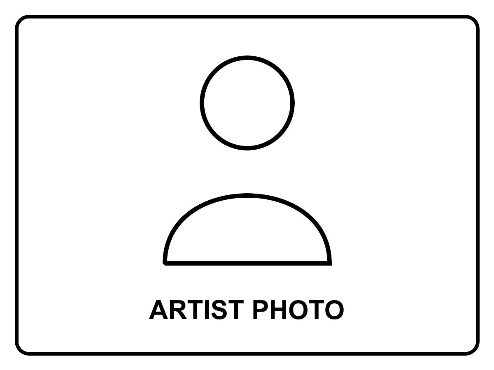

# Hello

This is the **sample** About text for Craft Showcase. On a real site the artist writes a few words here about
who they are, what they make and how they got started.

## How it works

Write plain paragraphs, `#` headings, **bold** and *italic* words, and links like
[the Craft Showcase code](https://github.com/rbrock44/craft-showcase). Photos go in `images/about/` and show
wherever a line like the one above names them.

Delete this file and the info button at the top right goes away.
